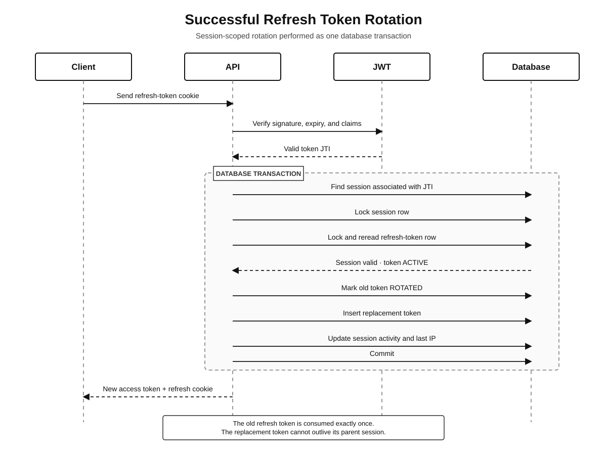
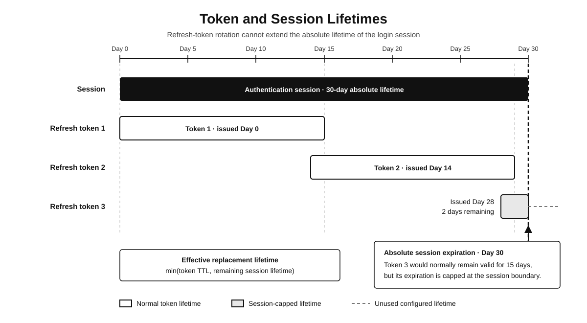

# HobbyHub

**Hobbyhub** is a continuous long-term learning project deliberately built through reading documentation, hands-on coding, watching videos, and getting worded feedback from AI regarding code quality, software design, and architectural decisions.

In doing so, I hope to establish a non-superficial understanding of each tool, technology, and concept I encounter while developing the full-stack project and adding more features.

**Hobbyhub** as an application is meant to be a LinkedIn-esque platform that is instead focused on creating a dedicated space for a wide variety of hobbies. I chose this type of project to help me cover a wide-range of software engineering topics and areas.

---

### Tech Stack

- **P**ostgreSQL
- **E**xpress
- **R**eact
- **N**ode.js

Currently, the application is built using a decoupled, [three-tier architecture](https://www.ibm.com/think/topics/three-tier-architecture).

---

<details open>
<summary> <h3>Notable Tools, Features, and Concepts learned so far...</h3></summary>

- **Refresh Token Rotation Architecture With Token-Family Management**
- **Silent Refreshing with Axios Interceptors**
- **Runtime Data Validation with Zod**
- **XSS and CSRF prevention with httpOnly and sameSite Cookies**
- **Custom Error Handling Architecture**
- **Database Pooling, Migration, and Seeding**
- **Indexes, Triggers, and Transactions**
- **Deferrable Constraints and Unique Partial Indexes**
- **Typescript and Implementing a Statically Type-Checked Codebase**
- **Vitest and Supertest**
- **Controller-Service-Repository (CSR) Pattern**
- **CORS Configuration**
- **Axios Instances**
- **React Context API**
- **React Router**
- **React Rendering Behavior**
- **Tailwind**

</details>

## Refresh Token Rotation Architecture With Token-Family Management

Each successful login creates an independent authentication session, represented as a token family. Refresh tokens rotate within that session, allowing multiple login sessions to be managed independently while enforcing an absolute session lifetime.

The architecture uses a hybrid authentication model: short-lived access tokens remain stateless, allowing ordinary authenticated requests to be authorized without a database session lookup, while refresh tokens and session state are persisted to support rotation, revocation, lifecycle tracking, and session-level control. This reduces the per-request storage and database overhead associated with fully stateful server-side sessions while retaining control over long-lived authentication.

### Successful Rotation Sequence



A successful refresh is performed as one database transaction. The session and refresh-token rows are locked before their state is evaluated, preventing concurrent requests from independently rotating the same token.

### Database Invariants

The database enforces authentication rules in addition to application-level validation. This prevents invalid token and session states from being persisted if application logic fails or concurrent requests occur.

| Invariant                                                                       | Database enforcement                   |
| ------------------------------------------------------------------------------- | -------------------------------------- |
| Every refresh token belongs to exactly one session                              | Non-null `session_id` foreign key      |
| A session has at most one active refresh token                                  | Partial unique index on active tokens  |
| An active token has no replacement or lifecycle timestamp                       | Status consistency check constraint    |
| A rotated token has a replacement and rotation timestamp                        | Status consistency check constraint    |
| A revoked token has a revocation timestamp                                      | Status consistency check constraint    |
| An active session has no revocation metadata                                    | Session consistency check constraint   |
| A revoked session has a reason and timestamp                                    | Session consistency check constraint   |
| Session and token expiration must occur after creation                          | Expiration check constraints           |
| Activity and revocation timestamps cannot precede session creation              | Timestamp validity constraints         |
| Deleting a session removes its associated token family                          | Cascading session foreign key          |
| A replacement link may reference a token inserted later in the same transaction | Deferred replacement-token foreign key |
| Rotation cannot leave only half of the required state changes persisted         | Database transaction                   |
| Concurrent refreshes within one session are evaluated sequentially              | Row-level locking                      |

Expiration is derived from `expires_at` rather than stored as an additional status. Authorization logic always evaluates both the stored lifecycle status and the relevant expiration timestamp.

### Token and Session Lifetimes

A refresh token has a shorter lifetime than its parent session. Rotation can renew the refresh credential, but it cannot extend the absolute lifetime of the original login session.



For example:

```text
Session created:                         Day 0
Session expires:                         Day 30

Token 1 issued:                          Day 0
Token 1 normally expires:                Day 15

Token 2 issued through rotation:         Day 14
Token 2 normally expires:                Day 29

Token 3 issued through rotation:         Day 28
Normal refresh-token expiration:         Day 43
Actual expiration after session cap:     Day 30
```

The effective replacement-token lifetime is:

```text
minimum(configured refresh-token lifetime, remaining session lifetime)
```

This prevents continuous rotation from keeping a session alive indefinitely.

### Edge-Case Handling

| Condition                                              | Result                                                                     |
| ------------------------------------------------------ | -------------------------------------------------------------------------- |
| Valid active token and active session                  | Rotate the refresh token and issue a new access token                      |
| Unknown token identifier (`jti`)                       | Reject the refresh request                                                 |
| Invalid JWT signature                                  | Reject the refresh request                                                 |
| Malformed or unexpected JWT claims                     | Reject the refresh request                                                 |
| Expired JWT                                            | Reject the refresh request                                                 |
| Expired refresh-token database record                  | Reject the refresh request                                                 |
| Revoked refresh token                                  | Reject the refresh request                                                 |
| Previously rotated refresh token                       | Reject the refresh request                                                 |
| Expired authentication session                         | Require the user to authenticate again                                     |
| Revoked authentication session                         | Require the user to authenticate again                                     |
| Two requests submit the same active token concurrently | Serialize the requests; only the first request can rotate the active token |
| Replacement token would outlive its session            | Cap the replacement expiration at the session expiration                   |
| Rotation fails before commit                           | Roll back every token and session change                                   |
| Client IP is unavailable                               | Preserve authentication behavior without treating the IP as identity       |
| One session is revoked                                 | Other sessions belonging to the same user remain unaffected                |
